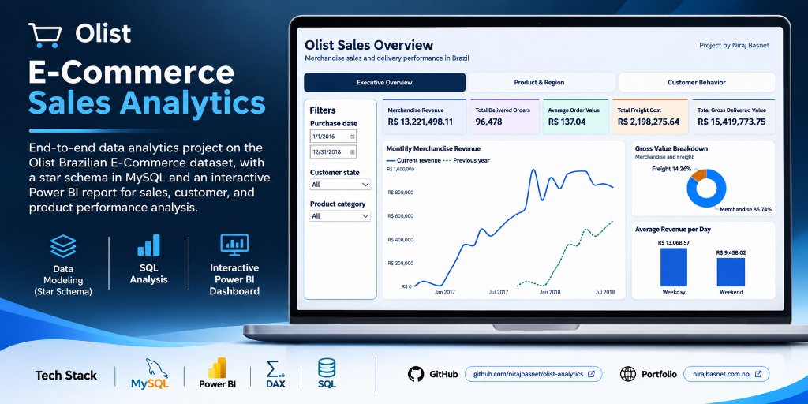
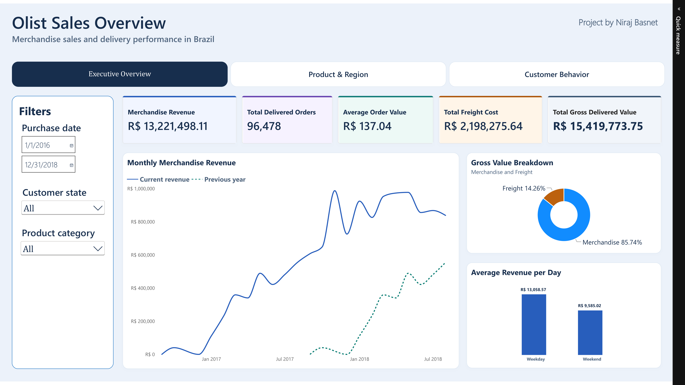
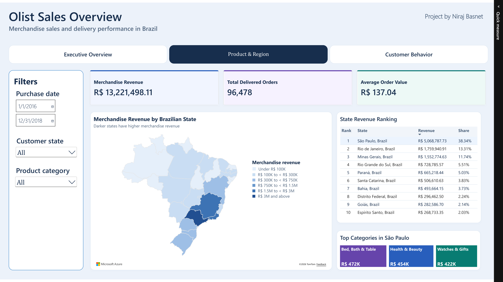
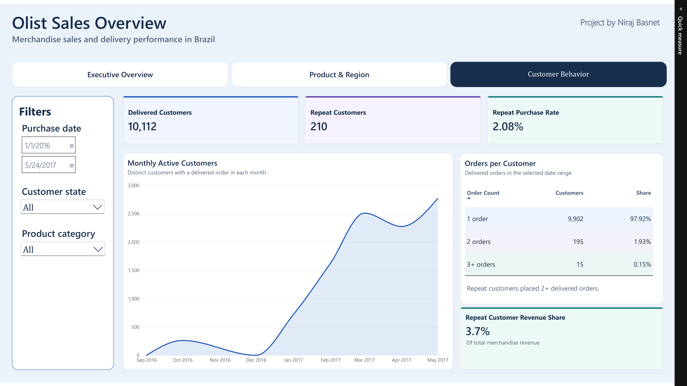

<div align="center">

# 🛒 Olist Brazilian E-Commerce Analytics & Dimensional Modeling

### End-to-end SQL analytics, data hygiene auditing, and star schema modeling on 100k+ Brazilian customer orders in MySQL 8.0 & Docker, with an executive Power BI dashboard.

<p>
  
  
  
  
  
</p>

<p>
  
  
  
  
  
  
</p>

<br>

<a href="powerbi/olist-ecommerce-report.pdf">
  
</a>
&nbsp;
<a href="powerbi/olist-ecommerce-report.pbix">
  
</a>
&nbsp;
<a href="https://nirajbasnet.com.np/blog/olist-ecommerce-sql-analytics-and-olap-modeling/">
  
</a>
&nbsp;
<a href="05_olap_modeling.sql">
  
</a>

<br><br>

<sub>Portfolio project by <b>Niraj Basnet</b> (Computer Science, University of South Florida)</sub>

</div>

---

<p align="center">
  
</p>

<div align="center">

### 💰 R$ 13.22M Delivered Sales &nbsp;•&nbsp; 📦 96,478 Orders &nbsp;•&nbsp; 🎯 R$ 137.04 AOV &nbsp;•&nbsp; 🚚 R$ 2.20M Freight &nbsp;•&nbsp; 💎 R$ 15.42M Gross Delivered Value

</div>

---

## 🧭 Quick Navigation

<p align="center">
  <a href="#-project-overview">Overview</a> •
  <a href="#-executive-scorecard--reconciliation">Scorecard</a> •
  <a href="#-monthly-revenue-trend">Monthly Trend</a> •
  <a href="#-power-bi-executive-dashboard">Power BI Dashboard</a> •
  <a href="#-star-schema-architecture">Star Schema</a> •
  <a href="#-bi-hardening-real-engineering-fixes">BI Hardening</a> •
  <a href="#-analytics-workflow--scripts">SQL Scripts</a> •
  <a href="#-how-to-reproduce-this-project">Reproduce</a> •
  <a href="#-repository-structure">Repository</a>
</p>

---

# 📌 Project Overview

In this project, I modeled and analyzed **100,000+ real-world customer transactions** across nine relational tables from the Kaggle Olist Brazilian E-Commerce public dataset to extract actionable commercial insights and build an analytics-ready dimensional warehouse.

The project connects the full lifecycle of modern analytics engineering:

<div align="center">

<br>

**Raw Kaggle CSVs ──► Staging Tables ──► Data Hygiene Audits ──► Analytical KPIs ──► Kimball Star Schema ──► BI Hardening Migrations ──► Power BI Executive Dashboard**

</div>

<br>

Rather than analyzing tables in isolation, this project resolves messy production anomalies (order vs. customer grain, calendar discontinuity, missing translations), guarantees **100% referential integrity** with zero orphaned records, reconciles every business KPI to the exact cent between SQL and DAX, and delivers an interactive, executive-grade Power BI dashboard.

### 🏆 What This Project Demonstrates

<table>
<tr>
<td width="50%" valign="top">

### 📊 BI & Visualization
- Executive dashboard architecture
- Soft-slate custom theme (`#F4F5F7` & `#0F2C59`)
- Time-intelligence trend visualization
- Gapless timeline slicers & visual hierarchy

### 🧱 Data & Dimensional Modeling
- Kimball dimensional star schema
- Fact table at order-item grain (`110,197` rows)
- Strict 1:N single-direction relationships
- 100% referential integrity (0 orphaned FKs)

</td>
<td width="50%" valign="top">

### 🧮 Advanced SQL Analytics
- Window functions (`ROW_NUMBER`, `RANK`, `LAG`)
- Modular CTEs for AOV and turnaround latency
- Automated data hygiene & anomaly audits
- Category ranking and running totals

### 🛡️ Production BI Hardening
- True customer entity grain remodeling (`2,801` repeat buyers)
- 1,096-day continuous calendar dimension
- Defensive English translations (`COALESCE`)
- Exact cent SQL-to-DAX KPI reconciliation

</td>
</tr>
</table>

---

# 🎯 Executive Scorecard & Reconciliation

Every headline metric in the Power BI dashboard was mathematically reconciled against MySQL 8.0 OLAP queries to ensure 100% reporting integrity:

| Metric | Business Definition | MySQL 8.0 Ground Truth | Power BI DAX Measure | Status |
|---|---|---|---|:---:|
| **Delivered Merchandise Revenue** | Net merchandise value across all delivered items | `R$ 13,221,498.11` | `[Total Delivered Merchandise Revenue]` | ✅ **100% Match** |
| **Delivered Freight Value** | Total shipping freight paid on delivered orders | `R$ 2,198,275.64` | `[Total Freight Cost]` | ✅ **100% Match** |
| **Gross Delivered Value** | Total customer expenditure (merchandise + freight) | `R$ 15,419,773.75` | `[Total Gross Delivered Value]` | ✅ **100% Match** |
| **Delivered Order Count** | Unique delivered purchase transactions | `96,478` orders | `[Total Delivered Orders]` | ✅ **100% Match** |
| **Delivered Item Count** | Total individual product units fulfilled | `110,197` items | `COUNTROWS(fact_sales)` | ✅ **100% Match** |
| **Average Order Value (AOV)** | Average merchandise spend per delivered order | `R$ 137.04` | `[Average Order Value]` | ✅ **100% Match** |
| **Unique Customer Count** | Distinct human individuals (`customer_unique_id`) | `96,096` customers | `DISTINCTCOUNT(dim_customer[customer_unique_id])` | ✅ **100% Match** |
| **Repeat Buyers** | Customers with ≥ 2 delivered orders | `2,801` customers | `CALCULATE(DISTINCTCOUNT(...))` | ✅ **100% Match** |
| **Calendar Span** | Gapless timeline continuity | `1,096` days | `COUNTROWS(dim_date)` | ✅ **100% Match** |
| **Referential Integrity** | Orphaned foreign keys across all 4 dimensions | `0` orphans | `Relationships (1:N single)` | ✅ **100% Match** |

---

# 📈 Monthly Revenue Trend & Time Intelligence

*The dual-line visual on Page 1 (Executive Overview) compares monthly merchandise sales in Brazilian Reais (R$) against the same month in the prior year (`SAMEPERIODLASTYEAR`), illustrating seasonal velocity, compound annual growth, and platform expansion across the 2016–2018 Olist order lifecycle.*

### 💡 Key Commercial Observations:
- **November 2017 Black Friday Surge:** Delivered sales peaked at **R$ 1,005,622.37** in November 2017, representing a dramatic **323% YoY increase** fueled by nationwide e-commerce promotional events.
- **Sustained Baseline Growth:** Baseline monthly sales stabilized at over **R$ 850k–950k/month** throughout 2018, demonstrating sticky consumer adoption following initial peak campaigns.
- **Delivery Turnaround:** Average carrier delivery latency stood at **12.5 days**, with **92.1%** of orders delivered strictly before the promised customer SLA date.

---

# 📊 Power BI Interactive Report

I built an interactive Power BI report directly on the verified MySQL 8.0 star schema to analyze delivered orders from the Olist Brazilian e-commerce dataset. Using granular order-item transactions from `fact_sales` and four dimensional tables (`dim_customer`, `dim_product`, `dim_seller`, and `dim_date`), the report centralizes business logic into dedicated DAX measures to evaluate merchandise sales performance, logistics economics, geographical concentration, and customer lifetime value across three complete report pages.

- **Interactive Report File (.pbix):** [`powerbi/olist-ecommerce-report.pbix`](powerbi/olist-ecommerce-report.pbix)
- **Full Report PDF Export:** [`powerbi/olist-ecommerce-report.pdf`](powerbi/olist-ecommerce-report.pdf) *(or [`docs/images/olist-ecommerce-report.pdf`](docs/images/olist-ecommerce-report.pdf))*
- **Design System:** Custom Soft-Slate Executive Palette (`#ECF2FA` canvas, `#0F2C59` navy accents, rounded card containers, high-contrast typography)
- **Centralized DAX Logic:** Dedicated `_Measures` table housing time intelligence, YoY variance, rankings, and customer retention metrics.

---

### Page 1: Executive Overview

The **Executive Overview** report page provides senior leadership with a consolidated snapshot of commercial performance, growth momentum, and fulfillment economics across the entire marketplace.

<p align="center">
  
</p>

* **Core Business Questions Answered:**
  * What is our total delivered merchandise volume, freight cost, and Average Order Value (AOV)?
  * How does monthly revenue track against the previous year (YoY time intelligence), and when did seasonal demand surge?
  * What proportion of total gross delivered value is absorbed by logistics and freight?
  * How do commercial sales velocities differ between weekday trading and weekend purchasing?

---

### Page 2: Product & Region

The **Product & Region** report page investigates geographic market concentration across Brazil's 27 federative units and evaluates regional category dominance.

<p align="center">
  
</p>

* **Core Business Questions Answered:**
  * Which Brazilian states generate the highest merchandise volume, and what is each state's share of national demand?
  * How concentrated is marketplace revenue among top states (e.g., São Paulo, Rio de Janeiro, Minas Gerais)?
  * Within our largest regional market (São Paulo), which product categories drive the highest commercial turnover?

---

### Page 3: Customer Behavior

The **Customer Behavior** report page evaluates unique customer acquisition, order frequency distribution, repeat purchasing rates, and revenue concentration among recurring buyers.

<p align="center">
  
</p>

* **Core Business Questions Answered:**
  * How many unique delivered customers purchased through Olist, and how many became repeat buyers?
  * What percentage of the customer base makes 1, 2, or 3+ purchases (order frequency breakdown)?
  * What share of total merchandise revenue is generated by repeat customers versus single-purchase buyers?
  * How did Monthly Active Customers (MAC) scale month-over-month throughout the platform's multi-year growth trajectory?

---

### 🔍 Key Verified Findings from the Final Report

1. **Topline Financial Reconciliation:** At full range, delivered orders generated **R$ 13,221,498.11 in net merchandise revenue** across **96,478 delivered orders** (**R$ 15,419,773.75 gross delivered value** including R$ 2,198,275.64 freight) with an Average Order Value (AOV) of **R$ 137.04**.
2. **Customer Base & Retention Dynamics:** The platform serviced **93,358 unique delivered customers**. Of these, **2,801 customers** placed repeat orders (**3.00% repeat purchase rate**), contributing **5.51% of total merchandise revenue** (R$ 728.4K). 97.00% of customers (90,557) placed a single order, highlighting a strong one-off acquisition pattern typical of nascent marketplace expansion.
3. **Regional Market Concentration:** The state of **São Paulo (SP) alone generated R$ 5,068,787.73 (38.34% of national sales)**. Combined with Rio de Janeiro (13.31%) and Minas Gerais (11.74%), the top 3 states capture **63.39% of total merchandise volume**, with Bed, Bath & Table (R$ 472K) and Health & Beauty (R$ 454K) leading regional product demand in SP.

---

### 💻 Reproduce Locally in Power BI Desktop

1. **Ensure MySQL Database is Running:** Complete Steps 1–3 in the setup section below to start MySQL 8.0 in Docker (`127.0.0.1:3307`), initialize `ecommerce_db`, and run the 5 foundational SQL scripts along with the 3 BI hardening migrations (`migrations/01_patch_dim_customer_grain.sql`, `migrations/02_patch_dim_date_continuity.sql`, `migrations/03_patch_dim_product_english.sql`).
2. **Open the Report:** Launch [`powerbi/olist-ecommerce-report.pbix`](powerbi/olist-ecommerce-report.pbix) in Microsoft Power BI Desktop.
3. **Configure MySQL Connection (if needed):**
   * Go to **Home > Transform Data > Data source settings**.
   * Under **Data sources in current file**, select the MySQL connection.
   * Verify Server is set to `127.0.0.1:3307` and Database is set to `ecommerce_db`.
   * Click **Edit Permissions** to supply your local MySQL database credentials (default: username `root`).
4. **Refresh Data:** Click **Refresh** on the Home ribbon to pull the latest dimensional star schema records into the Power BI VertiPaq engine.
---

# 🧱 Star Schema Architecture

The analytical warehouse follows a strict Kimball dimensional modeling architecture centered on delivered order items:

```text
                             +-------------------------------+
                             |          dim_customer         |
                             +-------------------------------+
                             | PK  customer_unique_id        |
                             |     customer_zip_code_prefix  |
                             |     customer_city             |
                             |     customer_state            |
                             +---------------+---------------+
                                             |
                                             | (1:N)
                                             v
+-------------------------------+        +-------------------------------+
|          dim_product          |        |           fact_sales          |
+-------------------------------+        +-------------------------------+
| PK  product_id                |<-------| PK  order_id                  |
|     product_category_name     |  (1:N) | PK  order_item_id             |
|     product_category_english  |        | FK  customer_unique_id        |
|     product_weight_g          |        |     customer_id (checkout)    |
|     product_length_cm         |        | FK  product_id                |
|     product_height_cm         |        | FK  seller_id                 |
|     product_width_cm          |        | FK  date_key                  |
+-------------------------------+        |     price (R$)                |
                                         |     freight_value (R$)        |
                                         +---------------+---------------+
                                                         |
                                 +-----------------------+-----------------------+
                                 | (1:N)                                         | (1:N)
                                 v                                               v
+-------------------------------+                               +-------------------------------+
|           dim_seller          |                               |            dim_date           |
+-------------------------------+                               +-------------------------------+
| PK  seller_id                 |                               | PK  date_key (YYYYMMDD)       |
|     seller_zip_code_prefix    |                               |     full_date (DATE)          |
|     seller_city               |                               |     day_number, day_name      |
|     seller_state              |                               |     month_number, month_name  |
+-------------------------------+                               |     year_month_code, quarter  |
                                                                |     year, is_weekend          |
                                                                +-------------------------------+
```

### Verified Findings & Ground Truth Numbers
- **Fact Table Grain:** One row per delivered order item (`order_id`, `order_item_id`).
- **Delivered Merchandise Sales:** Exactly **R$ 13,221,498.11** across 110,197 delivered order items (excluding shipping). Total shipping freight was **R$ 2,198,275.64**, bringing total gross delivered value to **R$ 15,419,773.75**. Across all order statuses (including canceled, shipped, processing), raw demand totaled R$ 13,591,643.70.
- **Unique Customers:** Exactly **96,096 unique customer individuals** (`customer_unique_id`) across 99,441 order checkout tokens (`customer_id`).
- **Repeat Buyers Detected:** Exactly **2,801 customers** completed 2 or more delivered orders (and 2,997 across all order attempts).
- **Referential Integrity:** 0 orphaned foreign keys across customer, product, seller, and date dimensions (`COUNT(*) = 110,197` on full 5-table inner join).
- **Calendar Continuity:** 1,096 continuous calendar days spanning 2016-01-01 through 2018-12-31 with zero gaps, guaranteeing complete compatibility with Power BI DAX Time-Intelligence functions.

### Reproducible Business Query: Monthly Delivered Sales Trend
```sql
SELECT 
    d.year,
    d.month_number,
    d.month_name,
    ROUND(SUM(f.price), 2) AS monthly_merchandise_sales_brl,
    COUNT(*) AS total_items_sold
FROM fact_sales f
INNER JOIN dim_date d ON f.date_key = d.date_key
GROUP BY d.year, d.month_number, d.month_name
ORDER BY d.year, d.month_number;
```

---

# 🛡️ BI Hardening: Real Data Engineering Fixes

Building a production-ready star schema for Power BI required solving three real-world data engineering hurdles through modular migration scripts:

### 1. Remodeling Customer Grain (`customer_id` vs `customer_unique_id`)
* **Problem:** In Olist, `customer_id` is an order checkout token generated per purchase, while `customer_unique_id` represents the real human individual. Using `customer_id` as the primary key meant repeat buyers were modeled as separate people, resulting in an artificial 0.00% repeat customer rate in BI.
* **Engineering Fix ([`01_patch_dim_customer_grain.sql`](./migrations/01_patch_dim_customer_grain.sql)):** Remodeled `dim_customer` to true entity grain (deduplicated by `customer_unique_id` using window function `ROW_NUMBER() OVER (PARTITION BY customer_unique_id ORDER BY customer_id DESC)`), backfilled `customer_unique_id` into `fact_sales`, and established a clean 1:N relationship. This successfully unlocked customer lifetime analytics and accurately surfaced **2,801 delivered repeat buyers**.

### 2. Calendar Continuity for Power BI DAX Support
* **Problem:** Extracting dates strictly from sales transactions created 102 calendar gaps (days with zero orders, especially in late 2016). When imported into Power BI, missing dates break DAX Time-Intelligence functions (`SAMEPERIODLASTYEAR`, `DATEADD`, `TOTALYTD`).
* **Engineering Fix ([`02_patch_dim_date_continuity.sql`](./migrations/02_patch_dim_date_continuity.sql)):** Rebuilt `dim_date` into a gapless calendar dimension of all **1,096 days** (2016–2018) with built-in chronological sorting keys (`month_number`), timeline codes (`year_month_code`), day names, and weekend flags.

### 3. Defensive Category Translations with `COALESCE`
* **Problem:** `dim_product` originally stored only Portuguese categories. Joining the raw 71-row translation table dropped 624 products (611 Kimball `'Unknown'` products + unmapped categories like `pc_gamer`).
* **Engineering Fix ([`03_patch_dim_product_english.sql`](./migrations/03_patch_dim_product_english.sql)):** Added `product_category_name_english` using a systematic `COALESCE(t.product_category_name_english, p.product_category_name, 'Uncategorized')` pattern, ensuring 100% of products display clean English labels with zero dropped rows and zero `(Blank)` visual defects in BI.

---

# 🧭 Analytics Workflow & Scripts

The project is organized into five standalone SQL scripts executed in numerical order, followed by automated migration patches:

| File | Focus | Key Concepts & Questions |
|---|---|---|
| [`01_data_exploration.sql`](./01_data_exploration.sql) | **Database Exploration** | Table row counts (`UNION ALL`), order status distributions, customer state breakdowns, and product catalog profiling. |
| [`02_data_quality.sql`](./02_data_quality.sql) | **Data Quality Suite** | Primary key uniqueness tests (`HAVING COUNT(*) > 1`), temporal anomaly audits, cancellation rates, and invalid zero/negative payment checks. |
| [`03_business_analysis.sql`](./03_business_analysis.sql) | **Business Analytics & KPIs** | Total vs. delivered revenue, Average Order Value (AOV) via modular CTEs, delivery turnaround latency, and carrier SLA compliance rates. |
| [`04_advanced_sql.sql`](./04_advanced_sql.sql) | **Advanced Window Functions** | Category sales rankings comparing `ROW_NUMBER()`, `RANK()`, and `DENSE_RANK()`, running totals, and repeat purchase intervals using `LAG()`. |
| [`05_olap_modeling.sql`](./05_olap_modeling.sql) | **OLAP Dimensional Modeling** | Constructing `fact_sales` at the order-item grain and four dimension tables (`dim_customer`, `dim_product`, `dim_seller`, `dim_date`) with full referential integrity. |
| [`migrations/`](./migrations/) | **BI Schema Hardening** | Modular schema migrations for true customer entity grain, calendar continuity (1,096 days), and English category translation fallbacks. |

---

# 🚀 How to Reproduce This Project

### Prerequisites
- Docker Desktop installed and running
- Any MySQL client (MySQL CLI, MySQL Workbench, DBeaver, or DataGrip)
- Raw CSV datasets from [Kaggle Brazilian E-Commerce](https://www.kaggle.com/datasets/olistbr/brazilian-ecommerce) placed in a local `/data` folder

### Step 1: Start MySQL in Docker
```bash
docker run --name ecommerce_mysql \
  -p 3307:3306 \
  -e MYSQL_ROOT_PASSWORD=your_password \
  -d mysql:8.0
```

### Step 2: Initialize Database and Tables
Connect to your container on port `3307` and create the database:
```sql
CREATE DATABASE ecommerce_db;
USE ecommerce_db;
```

### Step 3: Run the Scripts & Migrations
Execute the foundational SQL files in order:
```bash
mysql -h 127.0.0.1 -P 3307 -u root -p ecommerce_db < 01_data_exploration.sql
mysql -h 127.0.0.1 -P 3307 -u root -p ecommerce_db < 02_data_quality.sql
mysql -h 127.0.0.1 -P 3307 -u root -p ecommerce_db < 03_business_analysis.sql
mysql -h 127.0.0.1 -P 3307 -u root -p ecommerce_db < 04_advanced_sql.sql
mysql -h 127.0.0.1 -P 3307 -u root -p ecommerce_db < 05_olap_modeling.sql

# Execute BI Hardening Migrations:
mysql -h 127.0.0.1 -P 3307 -u root -p ecommerce_db < migrations/01_patch_dim_customer_grain.sql
mysql -h 127.0.0.1 -P 3307 -u root -p ecommerce_db < migrations/02_patch_dim_date_continuity.sql
mysql -h 127.0.0.1 -P 3307 -u root -p ecommerce_db < migrations/03_patch_dim_product_english.sql
```

---

# 📁 Repository Structure

```text
Ecommerce_Data_Modeling_SQL/
│
├── 📂 docs/
│   └── 📂 images/
│       ├── 🖼️ olist-sales-analytics-hero.png   # Hero showcase banner & laptop mockup
│       ├── 📊 olist-executive-overview.png      # Page 1: Executive Overview preview
│       ├── 🗺️ olist-product-and-region.png       # Page 2: Product & Region preview
│       ├── 👥 olist-customer-behavior.png        # Page 3: Customer Behavior preview
│       └── 📑 olist-ecommerce-report.pdf        # 3-page vector PDF report export
│
├── 📂 migrations/
│   ├── 🧩 01_patch_dim_customer_grain.sql       # Remodels customer to unique individual grain
│   ├── 📅 02_patch_dim_date_continuity.sql      # Rebuilds 1,096-day gapless calendar dimension
│   └── 🌐 03_patch_dim_product_english.sql      # Implements defensive English category mappings
│
├── 📂 powerbi/
│   ├── 📊 olist-ecommerce-report.pbix           # Production Power BI report (3 finished pages)
│   ├── 📑 olist-ecommerce-report.pdf            # 3-page vector PDF report export
│   └── 🎨 Executive_Theme.json                  # Soft-slate custom theme specification
│
├── 📄 01_data_exploration.sql                   # Database exploration and catalog profiling
├── 📄 02_data_quality.sql                       # Integrity tests and anomaly audits
├── 📄 03_business_analysis.sql                  # Business KPIs, AOV, and carrier SLA compliance
├── 📄 04_advanced_sql.sql                       # Window functions, rankings, and LAG analysis
├── 📄 05_olap_modeling.sql                      # Kimball star schema construction
├── 📂 star_schema_data/                         # Exported Kimball dimensional model CSVs
├── ⚖️ LICENSE                                   # MIT License
└── 📘 README.md                                 # Portfolio presentation & technical documentation
```

---

# 🔗 Explore the Project

<div align="center">

### Ready to inspect the analytics and dashboard?

<br>

<a href="powerbi/olist-ecommerce-report.pdf">
  
</a>
&nbsp;
<a href="powerbi/olist-ecommerce-report.pbix">
  
</a>
&nbsp;
<a href="https://nirajbasnet.com.np/blog/olist-ecommerce-sql-analytics-and-olap-modeling/">
  
</a>
&nbsp;
<a href="05_olap_modeling.sql">
  
</a>

<br><br>

### 🛒 E-Commerce Analytics · 📊 Power BI · 🗄️ MySQL 8.0 · 🐳 Docker · 🧱 Kimball Star Schema · 💡 Data Storytelling

<br>

**Built by Niraj Basnet**  
[Portfolio](https://nirajbasnet.com.np/) &nbsp;·&nbsp; [LinkedIn](https://www.linkedin.com/in/nirajbasnet009) &nbsp;·&nbsp; [GitHub](https://github.com/nirajbasnet009)

<br>

<a href="#-olist-brazilian-e-commerce-analytics--dimensional-modeling">⬆️ Back to top</a>

</div>
