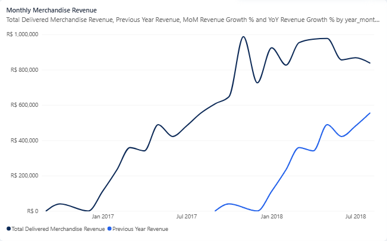
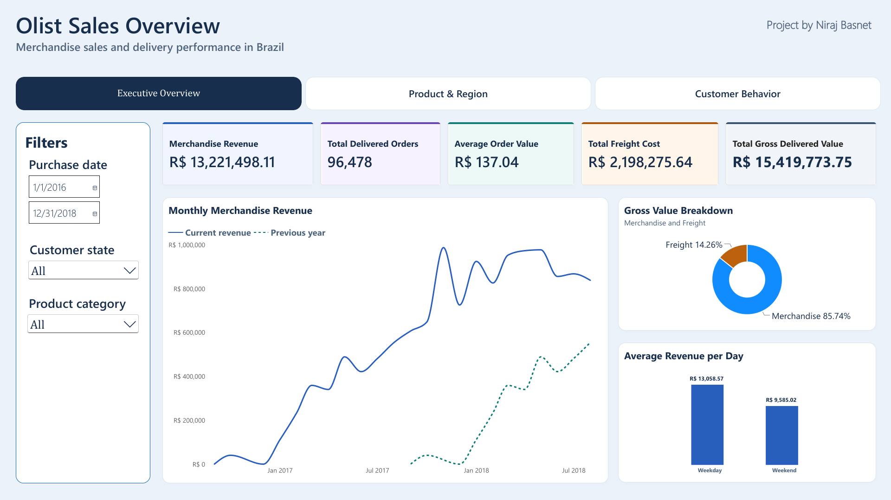

# Olist Brazilian E-Commerce SQL Analytics & OLAP Modeling

An end-to-end SQL analytics, data hygiene auditing, and dimensional modeling project analyzing over 100,000 real-world customer orders from the Olist Brazilian E-Commerce public dataset.

## Monthly Revenue Trend



*The two lines compare monthly merchandise revenue in Brazilian reais (R$) with the same month in the prior year, tracking seasonal momentum and annual growth across the Olist platform.*

> **Quick Summary for Reviewers:**
> - **What did I build?** An end-to-end SQL analytics pipeline and Kimball star schema (`fact_sales` + 4 dimensions) analyzing 100k+ Brazilian e-commerce orders in MySQL 8.0 on Docker, complete with post-modeling migration patches for BI dashboard readiness.
> - **What result or output can you see?** Verified 110,197 delivered order items accounting for **R$ 13,221,498.11** in delivered merchandise sales (**R$ 15,419,773.75** gross delivered value including freight), with 100% referential integrity and zero orphaned foreign keys across all 4 dimensions. (Gross raw demand across all order statuses totaled R$ 13,591,643.70).
> - **Which file should you open first?** Start with [`05_olap_modeling.sql`](./05_olap_modeling.sql) to inspect the star schema construction, followed by the [`migrations/`](./migrations/) directory for BI-hardening schema patches.

## 1. Project Overview

In this project, I modeled and analyzed 100,000+ customer transactions across nine relational tables from the Kaggle Olist Brazilian E-Commerce public dataset to extract actionable commercial insights and build an analytics-ready star schema. 

I resolved data quality anomalies, calculated core business KPIs with Common Table Expressions (CTEs), performed customer and category ranking with window functions, and constructed an analytical star schema centered on delivered order items (`fact_sales`) with 100% referential integrity across four dimensions.

### Current Status
- **SQL Analytics & OLAP Modeling:** Completed (50 SQL queries across 5 phases verified in MySQL 8.0 inside Docker).
- **BI Schema Migration & Hardening:** Completed (3 production migration patches resolving customer grain, calendar continuity, and category translations).
- **Power BI Reporting:** Completed (Interactive executive dashboard built on top of the hardened star schema in [`powerbi/ecommercereport.pbix`](./powerbi/ecommercereport.pbix)).

### Environment & Tools
- **DBMS:** MySQL 8.0 running inside Docker (`ecommerce_mysql` on port `3307`)
- **Database:** `ecommerce_db`
- **Volume:** 100,000+ orders (2016–2018)
- **Currency:** Brazilian Real (BRL, R$)
- **Tech Stack:** MySQL 8.0, Docker, SQL (CTEs, Window Functions, Dimensional Modeling, Schema Migrations), Git

---

## 2. Workflow & Repository Guide

The project is organized into five standalone SQL scripts executed in numerical order, followed by automated migration patches:

```text
Raw CSVs (Kaggle) ──► Staging Tables ──► Data Quality ──► Analytical KPIs ──► Star Schema (OLAP) ──► BI Migrations
```

| File | Focus | Key Concepts & Questions |
|---|---|---|
| [`01_data_exploration.sql`](./01_data_exploration.sql) | **Database Exploration** | Table row counts (`UNION ALL`), order status distributions, customer state breakdowns, and product catalog profiling. |
| [`02_data_quality.sql`](./02_data_quality.sql) | **Data Quality Suite** | Primary key uniqueness tests (`HAVING COUNT(*) > 1`), temporal anomaly audits, cancellation rates, and invalid zero/negative payment checks. |
| [`03_business_analysis.sql`](./03_business_analysis.sql) | **Business Analytics & KPIs** | Total vs. delivered revenue, Average Order Value (AOV) via modular CTEs, delivery turnaround latency, and carrier SLA compliance rates. |
| [`04_advanced_sql.sql`](./04_advanced_sql.sql) | **Advanced Window Functions** | Category sales rankings comparing `ROW_NUMBER()`, `RANK()`, and `DENSE_RANK()`, running totals, and repeat purchase intervals using `LAG()`. |
| [`05_olap_modeling.sql`](./05_olap_modeling.sql) | **OLAP Dimensional Modeling** | Constructing `fact_sales` at the order-item grain and four dimension tables (`dim_customer`, `dim_product`, `dim_seller`, `dim_date`) with full referential integrity. |
| [`migrations/`](./migrations/) | **BI Schema Hardening** | Modular schema migrations for true customer entity grain, calendar continuity (1,096 days), and English category translation fallbacks. |

---

## 3. How to Reproduce This Project

### Prerequisites
- Docker Desktop installed and running
- Any MySQL client (MySQL CLI, MySQL Workbench, DBeaver, or DataGrip)
- Raw CSV datasets from [Kaggle Brazilian E-Commerce](https://www.kaggle.com/datasets/olistbr/brazilian-ecommerce) placed in a local `/data` folder

### Step 1: Start MySQL in Docker
```bash
docker run --name ecommerce_mysql \
  -p 3307:3306 \
  -e MYSQL_ROOT_PASSWORD=your_password \
  -d mysql:8.0
```

### Step 2: Initialize Database and Tables
Connect to your container on port `3307` and create the database:
```sql
CREATE DATABASE ecommerce_db;
USE ecommerce_db;
```

### Step 3: Run the Scripts & Migrations
Execute the foundational SQL files in order:
```bash
mysql -h 127.0.0.1 -P 3307 -u root -p ecommerce_db < 01_data_exploration.sql
mysql -h 127.0.0.1 -P 3307 -u root -p ecommerce_db < 02_data_quality.sql
mysql -h 127.0.0.1 -P 3307 -u root -p ecommerce_db < 03_business_analysis.sql
mysql -h 127.0.0.1 -P 3307 -u root -p ecommerce_db < 04_advanced_sql.sql
mysql -h 127.0.0.1 -P 3307 -u root -p ecommerce_db < 05_olap_modeling.sql

# Execute BI Hardening Migrations:
mysql -h 127.0.0.1 -P 3307 -u root -p ecommerce_db < migrations/01_patch_dim_customer_grain.sql
mysql -h 127.0.0.1 -P 3307 -u root -p ecommerce_db < migrations/02_patch_dim_date_continuity.sql
mysql -h 127.0.0.1 -P 3307 -u root -p ecommerce_db < migrations/03_patch_dim_product_english.sql
```

---

## 4. Star Schema Architecture & Verified Results

### The Hardened Analytical Star Schema

```text
                             +-------------------------------+
                             |          dim_customer         |
                             +-------------------------------+
                             | PK  customer_unique_id        |
                             |     customer_zip_code_prefix  |
                             |     customer_city             |
                             |     customer_state            |
                             +---------------+---------------+
                                             |
                                             | (1:N)
                                             v
+-------------------------------+        +-------------------------------+
|          dim_product          |        |           fact_sales          |
+-------------------------------+        +-------------------------------+
| PK  product_id                |<-------| PK  order_id                  |
|     product_category_name     |  (1:N) | PK  order_item_id             |
|     product_category_english  |        | FK  customer_unique_id        |
|     product_weight_g          |        |     customer_id (checkout)    |
|     product_length_cm         |        | FK  product_id                |
|     product_height_cm         |        | FK  seller_id                 |
|     product_width_cm          |        | FK  date_key                  |
+-------------------------------+        |     price (R$)                |
                                         |     freight_value (R$)        |
                                         +---------------+---------------+
                                                         |
                                 +-----------------------+-----------------------+
                                 | (1:N)                                         | (1:N)
                                 v                                               v
+-------------------------------+                               +-------------------------------+
|           dim_seller          |                               |            dim_date           |
+-------------------------------+                               +-------------------------------+
| PK  seller_id                 |                               | PK  date_key (YYYYMMDD)       |
|     seller_zip_code_prefix    |                               |     full_date (DATE)          |
|     seller_city               |                               |     day_number, day_name      |
|     seller_state              |                               |     month_number, month_name  |
+-------------------------------+                               |     year_month_code, quarter  |
                                                                |     year, is_weekend          |
                                                                +-------------------------------+
```

### Verified Findings & Ground Truth Numbers
- **Fact Table Grain:** One row per delivered order item (`order_id`, `order_item_id`).
- **Delivered Merchandise Sales:** Exactly **R$ 13,221,498.11** across 110,197 delivered order items (excluding shipping). Total shipping freight was **R$ 2,198,275.64**, bringing total gross delivered value to **R$ 15,419,773.75**. Across all order statuses (including canceled, shipped, processing), raw demand totaled R$ 13,591,643.70.
- **Unique Customers:** Exactly **96,096 unique customer individuals** (`customer_unique_id`) across 99,441 order checkout tokens (`customer_id`).
- **Repeat Buyers Detected:** Exactly **2,801 customers** completed 2 or more delivered orders (and 2,997 across all order attempts).
- **Referential Integrity:** 0 orphaned foreign keys across customer, product, seller, and date dimensions (`COUNT(*) = 110,197` on full 5-table inner join).
- **Calendar Continuity:** 1,096 continuous calendar days spanning 2016-01-01 through 2018-12-31 with zero gaps, guaranteeing complete compatibility with Power BI DAX Time-Intelligence functions.

### Reproducible Business Query: Monthly Delivered Sales Trend
```sql
SELECT 
    d.year,
    d.month_number,
    d.month_name,
    ROUND(SUM(f.price), 2) AS monthly_merchandise_sales_brl,
    COUNT(*) AS total_items_sold
FROM fact_sales f
INNER JOIN dim_date d ON f.date_key = d.date_key
GROUP BY d.year, d.month_number, d.month_name
ORDER BY d.year, d.month_number;
```

---

## 5. BI Hardening: Real Data Challenges & Engineering Fixes

Building a production-ready star schema for Power BI required solving three real-world data engineering hurdles through modular migration scripts:

### 1. Remodeling Customer Grain (`customer_id` vs `customer_unique_id`)
* **Problem:** In Olist, `customer_id` is an order checkout token generated per purchase, while `customer_unique_id` represents the real human individual. Using `customer_id` as the primary key meant repeat buyers were modeled as separate people, resulting in an artificial 0.00% repeat customer rate in BI.
* **Engineering Fix ([`01_patch_dim_customer_grain.sql`](./migrations/01_patch_dim_customer_grain.sql)):** Remodeled `dim_customer` to true entity grain (deduplicated by `customer_unique_id` using window function `ROW_NUMBER() OVER (PARTITION BY customer_unique_id ORDER BY customer_id DESC)`), backfilled `customer_unique_id` into `fact_sales`, and established a clean 1:N relationship. This successfully unlocked customer lifetime analytics and accurately surfaced **2,801 delivered repeat buyers**.

### 2. Calendar Continuity for Power BI DAX Support
* **Problem:** Extracting dates strictly from sales transactions created 102 calendar gaps (days with zero orders, especially in late 2016). When imported into Power BI, missing dates break DAX Time-Intelligence functions (`SAMEPERIODLASTYEAR`, `DATEADD`, `TOTALYTD`).
* **Engineering Fix ([`02_patch_dim_date_continuity.sql`](./migrations/02_patch_dim_date_continuity.sql)):** Rebuilt `dim_date` into a gapless calendar dimension of all **1,096 days** (2016–2018) with built-in chronological sorting keys (`month_number`), timeline codes (`year_month_code`), day names, and weekend flags.

### 3. Defensive Category Translations with `COALESCE`
* **Problem:** `dim_product` originally stored only Portuguese categories. Joining the raw 71-row translation table dropped 624 products (611 Kimball `'Unknown'` products + unmapped categories like `pc_gamer`).
* **Engineering Fix ([`03_patch_dim_product_english.sql`](./migrations/03_patch_dim_product_english.sql)):** Added `product_category_name_english` using a systematic `COALESCE(t.product_category_name_english, p.product_category_name, 'Uncategorized')` pattern, ensuring 100% of products display clean English labels with zero dropped rows and zero `(Blank)` visual defects in BI.

---

## Author
**Niraj Basnet**  
Computer Science Undergraduate, University of South Florida  
- Portfolio: [nirajbasnet.com.np](https://nirajbasnet.com.np)  
- LinkedIn: [linkedin.com/in/nirajbasnet009](https://www.linkedin.com/in/nirajbasnet009)  
- GitHub: [github.com/nirajbasnet009](https://github.com/nirajbasnet009)


---

## 6. Power BI Executive Dashboard

An interactive, portfolio-grade executive dashboard designed on top of the hardened dimensional model:
* **Report File:** [`powerbi/ecommercereport.pbix`](./powerbi/ecommercereport.pbix)
* **Design System:** Custom Executive Palette (Soft Slate `#F4F5F7` canvas, `#0F2C59` navy accents)



### Features & Architecture:
1. **Executive Sales & Revenue Overview:**
   - **Executive KPI Cards:** Total Merchandise Revenue (R$ 13,221,498.11), Total Delivered Orders (96,478), Total Gross Delivered Value (R$ 15,419,773.75), Average Order Value (R$ 137.04).
   - **Monthly Merchandise Revenue Trend:** Dual-line comparison of current vs previous year revenue with Time-Intelligence DAX functions.
   - **Sales Velocity by Day of Week:** Visualizing daily sales velocity across weekdays and weekends.
   - **Interactive Date Slicers:** Gapless timeline navigation leveraging `dim_date`.
2. **Reconciliation & Integrity:**
   - Every KPI matches the verified MySQL OLAP queries to the exact cent, ensuring complete referential and mathematical consistency across the entire reporting layer.
